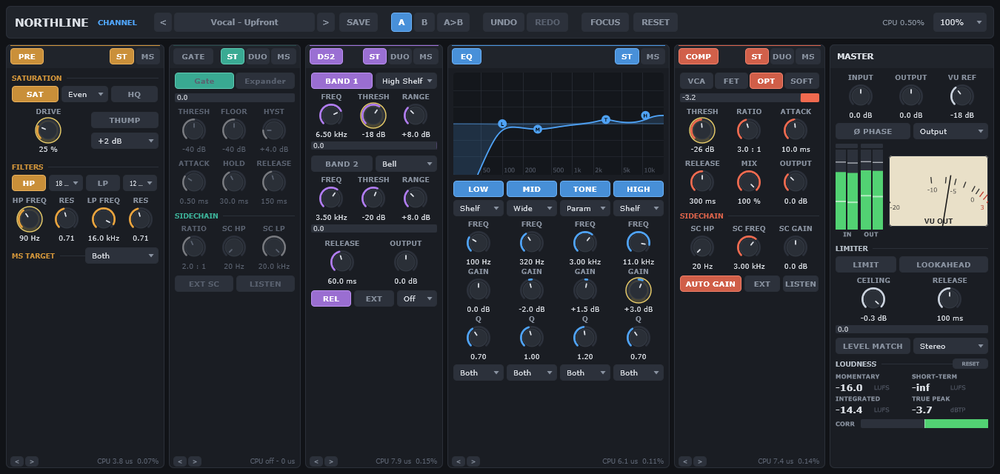

# Northline Channel

Northline Channel is a channel strip plug-in. It has five modules in a chain: PRE (saturation and
filters), GATE, DE-ESS, EQ and COMP. A master section holds a limiter, loudness metering and
Level Match. It runs at zero latency with the default settings, and it reports every latency it adds.



- **User manual:** [docs/manual](docs/manual/index.md)
- **Architecture:** [docs/ARCHITECTURE.md](docs/ARCHITECTURE.md)
- **Development:** [docs/DEVELOPMENT.md](docs/DEVELOPMENT.md)
- **Changes:** [CHANGELOG.md](CHANGELOG.md)
- **Measurements:** [docs/measurements](docs/measurements/README.md)
- **Plan and research:** [docs/ROADMAP.md](docs/ROADMAP.md), [docs/PLAN.md](docs/PLAN.md), [docs/research](docs/research)

## Features

- **PRE.** Seven saturation types (Odd, Even, Heavy, Crush, Tape, Tube, Transformer) with auto gain
  calibrated at the Operating Level. Eco runs at the base rate, and HQ runs at 4× with a linear-phase
  oversampler. High-pass and low-pass filters with slopes from 6 to 48 dB per octave. Weight, a
  low-frequency bump.
- **GATE.** Gate, expander and duck, with a high-pass and low-pass sidechain.
- **DE-ESS.** Two dynamic bands, each a low shelf, bell, narrow bell or high shelf, with relative detection.
- **EQ.** Four bands, each a shelf or a bell. Clean and Proportional Q behaviour. Dynamic band
  settings, and band solo, are available to the host.
- **COMP.** Four types (VCA, FET, OPT, SOFT), auto make-up gain and auto release, a sidechain filter and
  bell. The stereo link is available to the host.
- **Master.** A three-mode limiter: Safety Clip, Brickwall (1.5 ms lookahead) and True Peak (4× detector).
  EBU R128 loudness metering (BS.1770), true peak, LRA, a vectorscope and correlation, and loudness
  targets. Level Match in Learn and Live modes. Monitor modes.
- **Smart Start.** A starting point from a 12-second listen to one of nine sources. It is one undo step.
- **Instance Hub.** A table of every Northline instance in the plug-in process, with groups that link
  parameters across instances.
- **Presets.** 160 factory presets, a browser with search, favourites and folders, and module presets.
- **Tools.** Spotlight, labelled undo history (32 steps), A/B slots, Compare and module listens,
  interface size from 75 % to 200 %, dark and high-contrast themes.

Every module keeps its timing when it is switched off. The strip reports its total latency to the host.

## Formats and platforms

| Format | Windows x64 | macOS (universal) |
|---|---|---|
| VST3 | Yes | Yes |
| Standalone | Yes | Yes |
| Audio Unit | No | Yes |
| CLAP | Only with the optional CLAP checkout | Only with the optional CLAP checkout |

The measurement reports cover 44.1, 48, 96 and 192 kHz. The build uses JUCE 9.0.3.

## Build

Requires CMake 3.25 or later and a C++20 compiler: Visual Studio 2022 or later on Windows, and Xcode on
macOS.

```
git clone --depth 1 --branch 9.0.3 https://github.com/juce-framework/JUCE.git external/JUCE
cmake -S . -B build -G "Visual Studio 18 2026" -A x64
cmake --build build --config Release --target NorthlineChannel_VST3 NorthlineChannel_Standalone NorthlineTool -- -m
```

On macOS, use `cmake -S . -B build -G Xcode` and build the `NorthlineChannel_VST3` and
`NorthlineChannel_AU` targets. The VST3 bundle is in
`build/NorthlineChannel_artefacts/Release/VST3/Northline Channel.vst3`.

To install on Windows, copy that folder to `C:\Program Files\Common Files\VST3`. On macOS, copy it to
`~/Library/Audio/Plug-Ins/VST3`. The packaging scripts in `packaging/` build installers.

## Test, measure, bench and snapshot

The console tool `NorthlineTool` runs everything below. Its path on Windows is
`build/NorthlineTool_artefacts/Release/NorthlineTool.exe`.

```
NorthlineTool test [filter]                       # unit, realtime-safety and state tests
NorthlineTool measure <suite|all|list> [--out dir] [--quick]   # measurement reports
NorthlineTool bench [--quick]                     # CPU benchmark of this plug-in
NorthlineTool host-bench <file.vst3> [filter] [--quick]        # benchmark another VST3 the same way
NorthlineTool snapshot <out.png> [preset] [browser|smart|hub|settings]   # render the editor to a PNG
```

- `test` runs about 185 tests. A filter selects the tests whose names contain it.
- `measure` writes the reports in `docs/measurements`. See the [index](docs/measurements/README.md).
- `snapshot` renders the editor with a factory preset (`-1` turns every module on) and an optional
  overlay open. The screenshots in the manual come from it.

## Repository layout

| Path | Contents |
|---|---|
| `Source/Params.*` | The parameter table: IDs, ranges, defaults and flags |
| `Source/dsp/` | The strip, the five modules, the master section, meters and filters |
| `Source/gui/` | The editor: top bar, chain, module panels, master column, overlays |
| `Source/smart/` | Smart Start: capture, analysis and results |
| `Source/hub/` | The Instance Hub registry and groups |
| `Source/Presets.*`, `Source/FactoryPresets*.cpp` | Preset files, the library and the factory presets |
| `Source/PluginProcessor.*` | Host interface, state, presets, undo and A/B |
| `tools/` | The test, measurement, benchmark and snapshot code |
| `docs/` | The manual, architecture and development notes, DSP notes, measurements, research and the roadmap |
| `packaging/` | Installer scripts for Windows (Inno Setup) and macOS |
| `.github/workflows/` | Continuous integration and the release workflow |

## Licence

- Plug-in licence: [TBD]
- End-user licence agreement: [TBD], draft at `docs/legal/EULA.txt`
- Privacy policy: [TBD], draft at `docs/legal/PRIVACY.md`
- JUCE: used under the JUCE licence. Check its current terms before you sell the plug-in.
