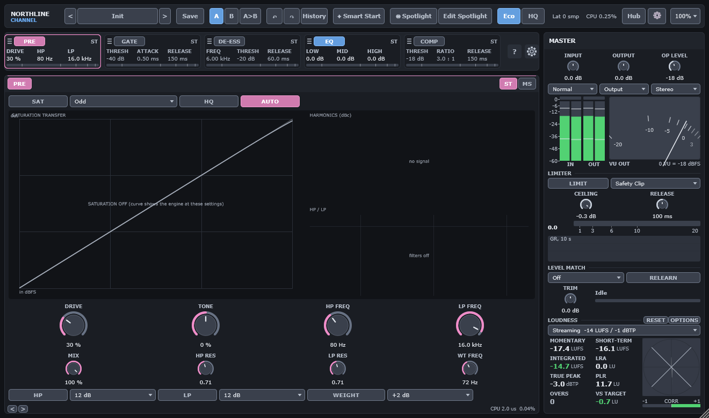
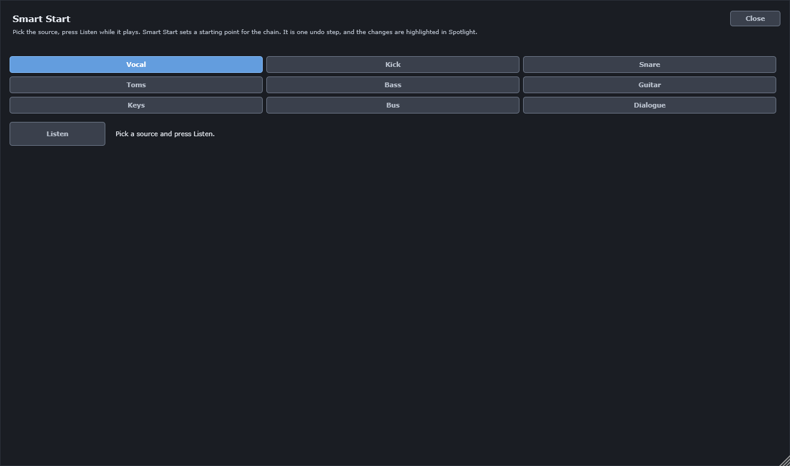

# 1. Getting started

## Requirements

| Item | Supported in this build |
|---|---|
| Plug-in formats | VST3 and Standalone on Windows (x64). VST3, AU and Standalone on macOS (universal). CLAP only when built with the optional CLAP checkout. |
| Hosts | Any VST3 host. AU hosts on macOS. |
| Sample rates | 44.1 kHz to 384 kHz. The filters, the limiter and the metering are designed for every rate in that range. |
| Channel layouts | Mono in and out, stereo in and out, and mono in to stereo out. |

Hardware: the strip is light. With every module on in Eco, one instance takes about 1 % of one
core at 48 kHz. Quality HQ on the saturation path costs more. See
[Troubleshooting](15-troubleshooting.md#cpu-use-is-high).

## Install

- **Windows.** Copy the `Northline Channel.vst3` folder to `C:\Program Files\Common Files\VST3`.
  The Windows installer (Inno Setup script in `packaging/windows`) does this for you when a release
  build provides one.
- **macOS.** The package script installs the VST3 bundle to `/Library/Audio/Plug-Ins/VST3`, the AU
  component to `/Library/Audio/Plug-Ins/Components`, and the CLAP plug-in to
  `/Library/Audio/Plug-Ins/CLAP` when it is built. For a single-user install, copy the VST3 bundle to
  `~/Library/Audio/Plug-Ins/VST3` instead.
- **Standalone.** Run the Standalone application. It has no host, so audio comes from your
  system device.

Rescan plug-ins in your host after you copy the file. If the plug-in does not show up, see
[Troubleshooting](15-troubleshooting.md#the-plug-in-does-not-appear-in-my-host).

## First use

1. Insert Northline Channel on a track or bus. The editor opens on the Init preset. Every
   module is at its default value, and the saturation, limiter and Level Match are off.
   
2. On the first run a four-step tour explains the chain, control editing, right-click and
   Spotlight, and Settings. Choose **Skip** to close it. Settings → **Show the first-run tour
   again** brings it back.
3. The top strip shows the five modules in chain order: PRE, GATE, DE-ESS, EQ, COMP. Click a
   card to open that module in the large area below.
4. Turn a knob by dragging it up or down. Shift gives fine steps. Double-click to type a value,
   for example `3k`, `-18`, `50%` or `100ms`. Alt-click (or Ctrl-click on Windows, Cmd-click on
   macOS) resets a control to its default.
5. Press the **?** button and turn on help mode if you want a short explanation when you hover
   over a control.

Chapter 13 lists every gesture.

## Smart Start

Smart Start listens to your source and proposes a starting point for the chain. It is one
undo step, and it highlights the parameters it changed in Spotlight.

1. Open Smart Start from the top bar.
2. Pick the source: Vocal, Kick, Snare, Toms, Bass, Guitar, Keys, Bus or Dialogue.
3. Press **Listen** and play the source. The capture lasts 12 seconds. Use the **Cancel**
   button to stop a capture or to discard a result you have not applied.
4. The analysis runs on a background thread. The panel then shows a summary of each change,
   with the value before and after.
5. Apply the result. The changes form one undo step. Use **Undo** (Ctrl+Z) to go back.

What the analysis sets, from the source code:

| Step | What it measures | What it sets |
|---|---|---|
| Level | 10th and 90th percentile of short-term level | The input gain, so the program sits at the Operating Level (chapter 2) |
| Low end | The lowest stable pitch (YIN estimator) | HP at 0.7 × the lowest pitch, held between 20 Hz and 150 Hz. Only when a pitch is found |
| Gate | The gap between noise and program levels | The gate on, with the threshold at the valley between them. The gate stays off when the gap is under 15 dB |
| Sibilance | Band energy in the sibilant range for the loudest events | DE-ESS band 1: on, type, frequency and threshold, for about 4.5 dB of gain reduction on those events |
| Tone | Long-term spectrum against a target curve for the source | EQ on, and up to two bands (the largest deviations first). Each band moves at most ±3 dB. Deviations under 1.5 dB are ignored |
| Dynamics | The crest factor and the level of the active segments | COMP on, type, threshold and ratio, for about 3.5 dB median gain reduction. Ratio is 2:1, 3:1 or 4:1 by crest factor |

Smart Start leaves the output gain, the limiter, the monitor and the Level Match setting alone.
It has no information about the rest of the mix. Judge its result by ear, and adjust it.

## Next steps

- Read chapter 2 to learn the signal order and the Operating Level. Most level-dependent
  behaviour is defined at the Operating Level (−18 dBFS RMS).
- Load a factory preset from the browser (chapter 12). Each preset lists the first control to
  adjust.
- Turn on the limiter (chapter 9) before you use the loudness readouts for a delivery target.
