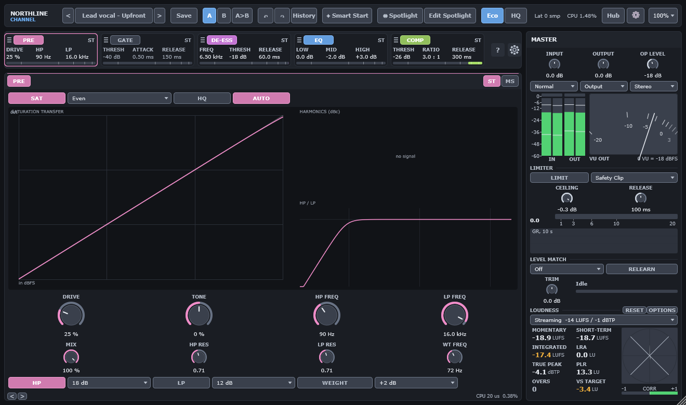

# 3. Top bar

The top bar is 44 px high and runs across the whole editor. From left to right:

| Control | What it does |
|---|---|
| `<` and `>` | Load the previous or next preset. The order is the factory presets, then your user presets. |
| Preset name | Shows the loaded preset, or `Init`. Click it to open the [preset browser](12-presets.md). |
| Save | Opens the Save menu (see below). |
| A and B | Select a compare slot. See [Compare and Delta](10-compare-and-delta.md). |
| A>B or B>A | Copies the active slot into the other slot. The label shows the direction. |
| Undo and Redo | Step back or forward through the labelled history. |
| History | Lists every undo step with its label. Choose a step to jump to it. |
| Smart Start | Opens the [Smart Start](01-getting-started.md#smart-start) panel. |
| Spotlight | Turns Spotlight focus on or off. |
| Edit Spotlight | Turns Spotlight edit mode on or off. |
| Eco and HQ | Sets the quality of the processing. See below. |
| Lat | The total latency of the strip, in samples. |
| CPU | The processing time of this instance, as a share of the block time. It is smoothed. |
| Hub | Opens the [Instance Hub](11-instance-hub.md). |
| Gear | Opens [Settings](13-settings-and-controls.md#settings). |
| Scale | Sets the size of this editor window: 75%, 100%, 125%, 150% or 200%. |

## Save menu

- **Save** overwrites the user preset you loaded, and keeps its name, category, tags and note. If you
  loaded a factory preset or Init, Save asks for a name, as Save as does.
- **Save as...** saves the current state as a new user preset.
- **Save module preset** saves one module (PRE, GATE, DE-ESS, EQ or COMP) to a `.nlmodule` file.
- **Load module preset...** loads a `.nlmodule` file into the module it contains.
- **Copy module** and **Paste module** move one module between instances through the clipboard, as
  XML text. Paste does nothing when the clipboard holds no module preset.

Chapter 12 describes where these files are stored.

## Undo and history

- Ctrl+Z (Cmd+Z on macOS) undoes the last change. Ctrl+Shift+Z or Ctrl+Y redoes it. The editor
  must have keyboard focus.
- The history holds 32 steps. Each step has a label, such as `Comp Threshold −18 → −22 dB`, or
  `HP On: Off → On`. The label names the change that made the step.
- Preset loads, A/B selections, module reorders, Smart Start results and the **Reset all settings**
  command each make one step.
- **History** lists the steps, newest first. Choose a line to jump to that state.

## Spotlight

Spotlight marks the controls a preset wants you to notice. Each factory preset has three to six
Spotlight controls. Spotlight is saved with the preset.

- **Spotlight** dims every control that is not in the Spotlight. Click it again to see all controls.
- **Edit Spotlight** turns on edit mode. In edit mode, a click on a control adds it to the
  Spotlight or removes it. Press Esc to leave edit mode.
- Right-click any control and choose **Add to Spotlight** or **Remove from Spotlight** to change it
  without edit mode.

Smart Start also writes its changed controls into the Spotlight, so you can see what it changed.

## Quality: Eco and HQ

Quality selects the processing path for the saturation and the limiter.

| Quality | What changes | Latency added |
|---|---|---|
| Eco | PRE saturation runs at the base rate, with first-order anti-derivative anti-aliasing (ADAA). The limiter Safety Clip has no oversampler. | 0 samples |
| HQ | PRE saturation runs at 4× with second-order ADAA and a linear-phase oversampler. The limiter Safety Clip runs at 4× too. | PRE 48 samples, Safety Clip 60 samples |

HQ costs more CPU. See [Troubleshooting](15-troubleshooting.md#cpu-use-is-high).

Quality is non-automatable. Changing it resets the delay lines, so it is not click-free, and it
changes the reported latency. Set it before you start the mix, not during playback.

## Latency and CPU readouts

- **Lat** is the total latency of the strip, as reported to the host. With Eco and Safety Clip it is
  0 samples. With HQ and Safety Clip it is 108 samples (48 + 60). With Brickwall at 48 kHz it is 72
  samples, or 120 with HQ.
- **CPU** shows the processing time of this instance. The Settings overlay can show a per-module
  breakdown instead (**Show CPU**).
