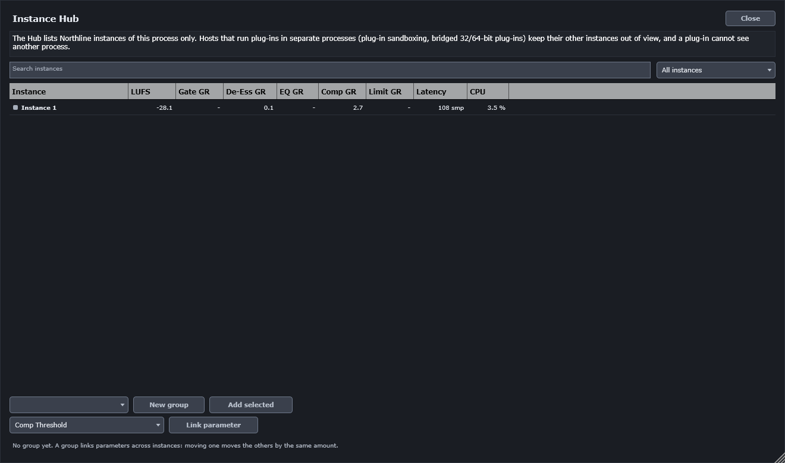

# 11. Instance Hub

The Instance Hub shows every Northline Channel instance in the current plug-in process. It lists
the loudness, the gain reduction of each module, the latency and the processing load of each
instance. You can use it to find the instance that is too loud, or to link one parameter across
several instances.

Open the Hub with the **Hub** button in the top bar. Close it with **Close** or Esc.

## Limit: this process only

The Hub sees only the instances in its own process. Some hosts run plug-ins in separate processes,
for example with plug-in sandboxing or with bridged 32-bit and 64-bit plug-ins. In those hosts, the
other instances are not visible to the Hub. The panel states this limit at the top, every time it
opens.

Test your host before you rely on the Hub across a mix. Open two instances, and check that both
appear.

## The table

| Column | Meaning |
|---|---|
| Instance | The track name from the host, or `Instance N` when the host gives no name. A coloured square shows the track colour when the host sends one. |
| LUFS | Integrated loudness of the instance, in LUFS. |
| Gate GR | Gain reduction of the gate, in dB. |
| De-Ess GR | Gain reduction of the de-esser, in dB. Band 1 and band 2 are combined into the larger value. |
| EQ GR | Largest dynamic-band gain change in the EQ, in dB. |
| Comp GR | Gain reduction of the compressor, in dB. |
| Limit GR | Gain reduction of the limiter, in dB. |
| Latency | The latency of the instance, in samples. |
| CPU | The processing share of the instance, smoothed. |

A dash means the module is off, or has no gain reduction to show.

Click a row to bring that instance's editor window to the front. The window has to be open. The Hub
does not change the instance; it only shows it to you.

### Search and filter

- **Search instances** filters the rows by name.
- The filter list chooses **All instances**, **Gain reduction now** (rows with any gain reduction
  at the moment) or **Hot: above -14 LUFS** (rows whose integrated loudness is above −14 LUFS).

## Groups

A group links one or more parameters across instances. A change to a linked parameter on one member
moves the same parameter on the other members by the same amount, so their offsets stay the same.
Use a group to set the threshold of every drum compressor at once, for example.

To make a group:

1. Press **New group**. The group is named `Group N`.
2. Select one or more rows and press **Add selected** to add those instances to the group.
3. Choose a parameter from the parameter list and press **Link parameter**.

From then on, a change to the linked parameter on one member moves the others. The Hub checks for
changes about every 30 ms, while any group exists.

- If two members move in the same check, the first one in the list wins.
- A group keeps working only for instances in the same process.

## Limits

- Only instances in the same process are shown or linked.
- Group propagation runs on the message thread, on a timer of 30 ms. A change may take up to about
  30 ms to reach the other members.
- Click on a row brings the editor forward. It does not open a second copy of the editor.
