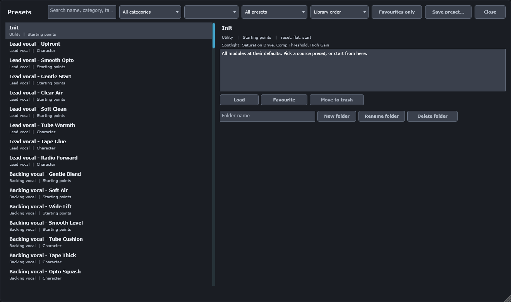

# 12. Presets and the preset browser

A preset is a saved setting of the whole strip. It holds the value of every parameter, the module
order, the Spotlight and the name. Northline Channel ships 160 factory presets. You can save your
own presets, and you can save and load one module at a time.

## Factory presets

- The library holds 160 presets, plus **Init**. Init sets every module to its default values.
- There are 20 source categories, with 8 presets in each: Lead vocal, Backing vocal, Rap vocal,
  Voice-over, Dialogue, Podcast, Kick, Snare, Toms, Overheads, Drum bus, Bass DI, Bass amp, Electric
  guitar, Acoustic guitar, Keys and piano, Synth, Strings, Mix bus and Room.
- Each preset is in one of two families:
  - **Starting points.** Gentle, specific to the source. Use these first.
  - **Character.** A clear colour, for example tape, tube or opto.
- Each preset has tags, such as `vocal, lead, tape`, a short note that says what to adjust first, and
  three to six Spotlight controls.
- Factory presets cannot be deleted or changed in place. Save a factory preset under a new name to
  keep your changes.

## Loading presets

- Click the preset name in the top bar to open the browser. Choose a preset, then **Load**.
- The **<** and **>** buttons in the top bar step through the library, factory presets first, then
  your user presets.
- A preset load is one undo step, labelled `Load preset: <name>`.
- Loading a preset resets the transient settings. The monitor and the listen buttons return to
  their defaults.

## The browser

| Area | Use |
|---|---|
| Search | Finds presets whose name, category, family, tags or note contain every word you type. |
| Category | Shows one category, or all of them. |
| Family | Shows Starting points or Character, or both. |
| Folder | Shows all presets, your root folder only, or one of your folders. |
| Sort | Library order, Name, Category, or Favourites first. |
| Favourites only | Shows only the presets you have marked. |
| Load | Loads the selected preset. |
| Favourite | Marks or unmarks the selected preset. |
| Move to trash | Moves a user preset to the operating system's trash. |
| Save preset... | Saves the current settings as a user preset. |
| New folder, Rename folder, Delete folder | Manage your user folders. |

The detail pane shows the category, family, tags, the Spotlight controls and the note of the
selected preset.

Deleting a folder moves the folder and its presets to the trash. A factory preset cannot be moved to
the trash.

## Saving a preset

1. Choose **Save preset...** in the browser, or **Save as...** from the top bar's Save menu.
2. Enter a name. The name is required. A name that is already used in the chosen folder is refused.
3. Choose a category. Enter tags as a comma-separated list. Write a short author note on what to
   adjust first.
4. Save. The file is written to your presets folder.

**Save** from the top bar overwrites the user preset you loaded. It keeps the name, category, tags
and note. If you loaded a factory preset or Init, Save asks for a name.

## Module presets

A module preset holds one module: PRE, GATE, DE-ESS, EQ or COMP. Use one to carry a compressor
setting from one instance to another.

- **Save module preset** in the top bar's Save menu writes a `.nlmodule` file.
- **Load module preset...** loads a `.nlmodule` file into the module it contains.
- **Copy module** and **Paste module** copy the module through the clipboard. The clipboard holds
  the module as XML text.

## What a preset holds, and what it does not

A preset holds:

- every parameter except the transient ones (monitor, the listen buttons, the EQ band solo);
- the module order;
- the Spotlight controls;
- the preset name.

It does not hold the loudness target or the meter options. Those are saved with the session. Level
Match is part of a preset, including its trim.

## Where files are stored

| What | Location on Windows |
|---|---|
| User presets (`.nlpreset`) | `Documents\Northline Audio\Northline Channel\Presets`, with folders |
| Module presets (`.nlmodule`) | `Documents\Northline Audio\Northline Channel\Modules` |
| Favourites | `AppData\Roaming\Northline Audio\Northline Channel\favourites.xml` |

On macOS the same folders are in your Documents and Application Support folders. Favourites apply to
all instances and all sessions, not to one project.

User presets are kept in the Documents folder, so they survive a reinstall of the plug-in.
