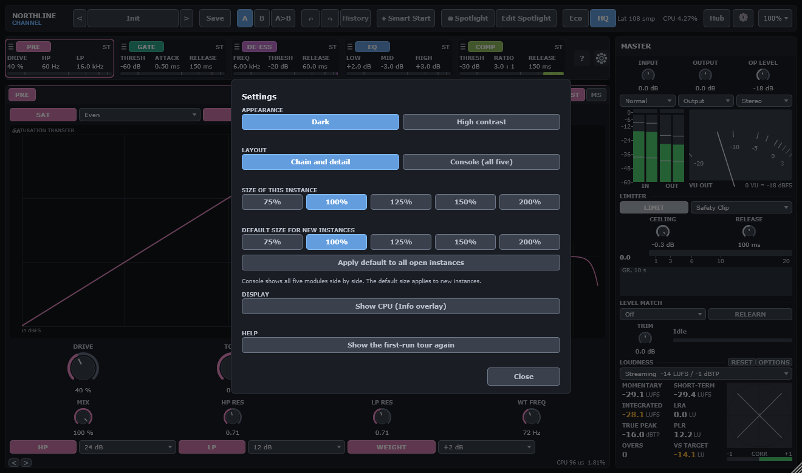

# 13. Settings, layout and controls

## Settings

Open Settings with the gear button in the top bar. Close it with **Close** or Esc.

| Group | Option | What it does |
|---|---|---|
| Appearance | Dark, High contrast | Chooses the colour theme. High contrast raises the contrast of text and controls. |
| Layout | Chain and detail | The default. One module is open at a time in the large area. |
| Layout | Console (all five) | All five modules side by side. The editor scrolls sideways. |
| Size of this instance | 75 %, 100 %, 125 %, 150 %, 200 % | Sets the size of this editor window. The size is saved with the session. |
| Default size for new instances | 75 % to 200 % | The size a new instance opens at. **Apply default to all open instances** resizes every open instance to it. |
| Display | Show CPU (Info overlay) | Opens a panel with the processing time of each module. |
| Help | Show the first-run tour again | Opens the four-step tour. |

## Layout and size

- The editor is designed on a canvas of 1320 × 780 px. The window scales with it.
- The **Scale** list in the top bar sets the size: 75 %, 100 %, 125 %, 150 % or 200 %.
- Drag the bottom-right corner of the window to resize it. The width sets the scale. The aspect
  ratio stays fixed.
- The **?** button in the chain strip turns on help mode. Hover over any control to see a short
  explanation of what it does, its range and its shortcut.
- The master column is always visible, 300 px wide, on the right.

## Mouse gestures

These gestures work on every knob and slider in the editor. The menu and the typed entry work on
every control that has a value.

| Gesture | Action |
|---|---|
| Drag up or down (or sideways) | Changes the value. A full range takes 200 px of drag. |
| Shift + drag | Fine adjustment, one tenth of the normal speed. |
| Mouse wheel | Steps the value by a small amount. |
| Shift + wheel | Fine steps. |
| Double-click | Opens a text box. Type a value with its unit, for example `3k`, `-18`, `50%`, `100ms` or `inf` for an infinite ratio. Press Return to apply. |
| Alt-click, or Ctrl-click (Windows), Cmd-click (macOS) | Resets the control to its default. |
| Right-click | Opens the control menu (see below). |
| Hover | Shows the value bubble. In help mode it shows the explanation too. |

Dropdowns step one option per wheel notch. The Page Up and Page Down keys step three options.

### Right-click menu

| Item | Action |
|---|---|
| Reset to default | Returns the control to its default value. |
| Enter value... | Opens the text box. |
| Copy value | Copies the value as text. |
| Paste value | Sets the value from the text on the clipboard, if it is a valid value. |
| Add to Spotlight, or Remove from Spotlight | Changes the Spotlight membership of the control. |

### Module-specific gestures

- **EQ curve.** Drag a band handle to change its frequency and gain. Shift makes the move one tenth
  as large. Double-click a handle to set that band's gain to 0 dB. The mouse wheel over a handle
  changes its Q.
- **COMP scope.** Click or drag in the scope to set the threshold to the pointer's level. Shift gives
  a fine move.
- **Chain cards.** Click a card to open its module in the detail area. Drag the handle (≡) on the left
  of a card to move it in the chain.

## Keyboard

| Key | Action |
|---|---|
| Ctrl+Z (Cmd+Z) | Undo. |
| Ctrl+Shift+Z or Ctrl+Y (Cmd+Shift+Z or Cmd+Y) | Redo. |
| Esc | Closes an overlay. Leaves Edit Spotlight mode. |
| Arrow keys (focused knob) | Change the value by 1 % of the range. Shift makes the step one tenth as large. |
| Page Up and Page Down (focused knob) | Change the value by 10 % of the range. |
| Return (focused knob) | Opens the text box. |
| Return or Space (focused chain card) | Opens the card's module in the detail area. |
| Left and Right (focused chain card) | Moves the focus to the next or previous card. |
| Alt+Left and Alt+Right (focused chain card) | Moves the card's module earlier or later in the chain. |
| Page Up and Page Down (focused dropdown) | Step three options. |

Keys that no control uses pass through to the host.

## Parameters without an editor control

Some parameters have no control in the editor. They are in the plug-in's parameter list. You can
automate them and save them in a session, and a preset can carry them. You cannot set them from the
editor in this build.

| Parameter | Range and default | Notes |
|---|---|---|
| Input Swap L/R (`in_swap`) | Off or on. Default off. | Swaps the left and right channels at the input. |
| Mix (`global_mix`) | 0 to 100 %. Default 100 %. | Dry and wet mix of the whole strip. Latency-aligned. |
| Weight Track HP (`weight_track`) | Off or on. Default off. | Makes the Weight bump follow the high-pass frequency. |
| GATE lookahead (`gate_lookahead`) | Off, 1, 2 or 5 ms. Default Off. | Not automatable. Adds latency. |
| DE-ESS lookahead (`ds_lookahead`) | Off, 1, 2 or 5 ms. Default Off. | Not automatable. Adds latency. |
| COMP lookahead (`comp_lookahead`) | Off, 1, 2 or 5 ms. Default Off. | Not automatable. Adds latency. |
| DE-ESS attack (`ds_attack`) | 0.05 to 5 ms. Default 0.4 ms. | Attack of the de-esser bands. |
| DE-ESS band mode (`ds1_mode`, `ds2_mode`) | Split or Wide. Default Split. | Wide applies the band's gain to the whole signal. |
| EQ band solo (`eq_solo`) | Off, Low, Mid, Tone or High. Default Off. | Transient. Not saved. |
| EQ dynamic bands (`eq_low_dyn`, and the same for the other bands) | Dynamic on, threshold, range, speed and external key for each band. See chapter 7. | Shown in the EQ display. |
| COMP stereo link (`comp_link`) | 0 to 100 %. Default 100 %. | Used in ST mode. In DUAL mode the link is off. |

The lookahead settings and the quality and limiter-mode settings are not automatable, so hosts do not
offer them for automation.

Chapter 2 explains the Operating Level, which is in the editor, and chapter 9 explains the limiter.
