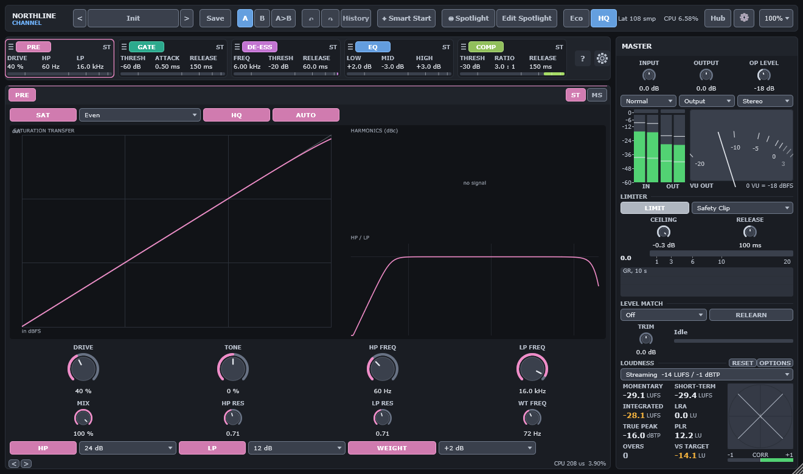

# Northline Channel: user manual

Northline Channel is a channel strip plug-in. It has five processing modules, a master
section with a limiter and loudness metering, presets, and a few tools for comparing and
matching your mix. This manual describes version 1.0.0-beta. Changes are listed in
[CHANGELOG.md](../../CHANGELOG.md).

## Chapters

1. [Getting started](01-getting-started.md): install, first use, Smart Start
2. [Signal flow and the Operating Level](02-signal-flow.md)
3. [Top bar](03-top-bar.md): presets, A/B, undo, Spotlight, quality, latency
4. [PRE](04-pre.md): saturation, filters, Weight
5. [GATE](05-gate.md): gate, expander and duck
6. [DE-ESS](06-de-esser.md): two-band de-esser
7. [EQ](07-eq.md): four bands
8. [COMP](08-compressor.md): four compressor types
9. [Master section](09-master.md): limiter, loudness, Level Match
10. [Compare and Delta](10-compare-and-delta.md)
11. [Instance Hub](11-instance-hub.md)
12. [Presets and the preset browser](12-presets.md)
13. [Settings, layout and controls](13-settings-and-controls.md): resizing, mouse and keyboard
14. [Accessibility](14-accessibility.md)
15. [Troubleshooting and FAQ](15-troubleshooting.md)
16. [Glossary](16-glossary.md)

## Conventions

- Values are shown with units. Gain is in dB, time in ms or s, frequency in Hz or kHz.
- "Default" means the value in a new instance (the Init preset).
- Settings marked **host only** have no control in the editor in this build. You can still
  reach them through your host's parameter list, automation, and the parameter values stored
  in a session. See [Parameters without an editor control](13-settings-and-controls.md#parameters-without-an-editor-control).
- Latency figures are in samples at 48 kHz unless marked otherwise. Full measurement reports are
  in [docs/measurements](../measurements/README.md).

## Screenshots

The screenshots are rendered by the project's own `snapshot` command, so they show the build in
this repository. They are not captured from a host.

